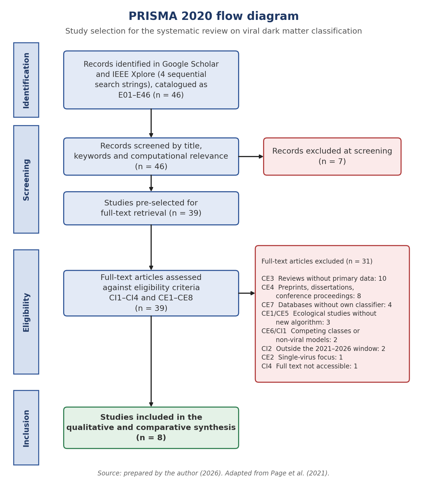

# Viral Dark Matter: A Systematic Review of Computational Methods for Classifying Divergent Viral Sequences in Metagenomic Data

Companion repository of the undergraduate thesis *"Matéria Escura Viral: uma Revisão Sistemática de Métodos Computacionais para Classificação de Sequências Virais Divergentes em Dados Metagenômicos"*. It contains the review protocol, the screening decisions and the data extracted from the included studies, so that each step of the review can be inspected.

- **Author:** Letícia Rosemberg Sousa
- **Advisor:** Felipe Bastos Nunes
- **Co-advisor:** Odara Sena dos Santos Feitosa
- **Institution:** Instituto Federal de Educação, Ciência e Tecnologia do Ceará (IFCE), B.Sc. in Computer Science

## Research question

> Which computational approaches have been developed to classify viral dark matter in metagenomic data, and how do they compare in terms of **scalability**, **sensitivity** and **generalisation capacity**?

"Viral dark matter" refers to viral sequences that current tools cannot recognise because they share little or no detectable homology with known references. Depending on the sample type, an estimated 40-90% of sequences in viral metagenomic analyses fall in this category (Galeeva et al., 2025).

## Review at a glance

| Item | Description |
| --- | --- |
| Guideline | PRISMA 2020, complemented by Kitchenham & Charters (2007) and SEGRESS |
| Databases | IEEE Xplore and Google Scholar |
| Period | 2021-2026 |
| Method families | Sequence alignment, k-mer based, profile HMM, deep learning (genomic foundation models discussed as an emerging trend) |
| Analytical dimensions | Sensitivity, scalability / computational cost, generalisation |

## Selection flow

| Stage | n |
| --- | --- |
| Records catalogued (IDs E01-E46) | 46 |
| Excluded at title/keyword screening | 7 |
| Assessed in full text | 39 |
| Excluded after full-text assessment | 31 |
| **Included in the synthesis** | **8** |

## Repository contents

| File | Content |
| --- | --- |
| [`protocol.md`](protocol.md) | Scope, search strings, eligibility criteria, extraction fields and appraisal |
| [`data/study_register.md`](data/study_register.md) | All 46 records with stage, decision and exclusion criterion |
| [`data/data_extraction.md`](data/data_extraction.md) | Characteristics of the 8 included studies |

Metrics are reported as published by each study's authors. Results obtained by tool developers on their own benchmarks are not directly comparable with independent benchmarks (see the appraisal section in the protocol).

Full-text PDFs are not distributed here for copyright reasons; use the DOIs in the original articles to retrieve them.

## How to cite

See [`CITATION.cff`](CITATION.cff). Suggested citation:

> SOUSA, Letícia Rosemberg. *Viral dark matter: a systematic review of computational methods for classifying divergent viral sequences in metagenomic data* (data and protocol). Undergraduate thesis, IFCE, 2026.

## License

Released under the [MIT License](LICENSE). Third-party articles remain under their own licenses.
